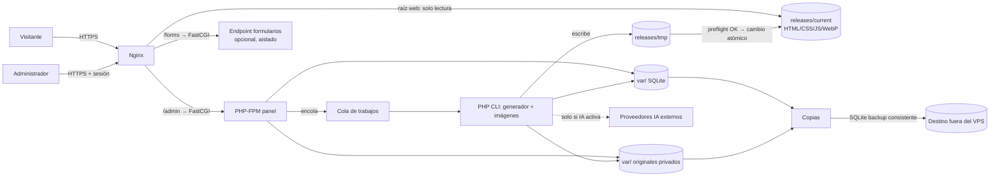

# Despliegue, flujos y límites de confianza

## Dominio y rutas

- Sitio público: `https://luxaeterna.es/` (raíz del dominio, sin subcarpeta).
- Panel: `https://luxaeterna.es/admin` (prefijo configurable).
- Proveedor: IONOS.

## Configuración de referencia (provisional)

Sin datos del VPS real, las mediciones usan **1 vCPU, 1 GB de RAM** (incluida la memoria del sistema), Ubuntu LTS, Nginx, PHP 8.3 (ver ADR-0001, ADR-0006). Se sustituirá por el inventario real cuando el propietario lo aporte.

## Diagrama de despliegue

Con PHP-FPM, SQLite, cola y generador detenidos, Nginx sigue sirviendo `current` (R01).

## Flujos principales

| Flujo | Origen → destino | Datos | Autoridad |
|---|---|---|---|
| Edición | Navegador → panel → SQLite | Contenido, ajustes | Panel (sesión + CSRF + permisos) |
| Subida | Navegador → panel → `var/originales` | Binarios no confiables | Panel valida por contenido |
| Derivados | Cola → CLI → caché WebP | Recetas, WebP | CLI (límites de CPU/RAM/tiempo) |
| Publicación | CLI lee instantánea → `releases/tmp` → `current` | HTML estático | Generador + preflight |
| Servicio público | Nginx → `current` | Archivos estáticos | Nginx (solo lectura) |
| Formularios | Visitante → endpoint aislado → destino | Datos personales | Endpoint propio, sin acceso a SQLite del panel |
| IA | Servidor → proveedor permitido | Texto/imagen con aprobación | Módulo IA (SSRF, claves cifradas) |
| Copias | SQLite/originales → destino externo | Copia consistente | Tarea programada, claves por canal aparte |

## Límites de confianza

1. **Internet ↔ Nginx.** Todo lo que llega es hostil.
2. **Nginx ↔ PHP-FPM.** Solo rutas `/admin` y `/forms` pasan a PHP; el resto es estático.
3. **Panel ↔ almacenamiento privado.** Solo el usuario de servicio del panel lee/escribe `var/`.
4. **Generador ↔ raíz pública.** Solo el publicador escribe `releases/`; Nginx solo lee; el código de la aplicación es de solo lectura en uso normal.
5. **CMS ↔ extensiones.** Los plugins PHP corren en el mismo proceso con los mismos permisos: instalarlos es una decisión de confianza del operador, no hay aislamiento por manifiesto.
6. **CMS ↔ servicios externos.** Solo destinos permitidos, desde servidor, con controles SSRF.

## Usuarios y permisos del sistema (objetivo)

| Usuario | Lee | Escribe |
|---|---|---|
| `www-data` (Nginx) | `releases/current`, `public/admin` | — |
| `luxaeterna-panel` (PHP-FPM) | código, `var/` | `var/` |
| `luxaeterna-publish` (CLI) | código, `var/` | `releases/` (+ `var/` temporales) |
| Despliegue (operador) | todo | código en actualizaciones |

El diseño detallado de permisos y ejemplos de Nginx se entregan en la Fase 1 (`deploy/`).
